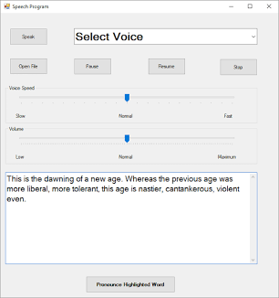

# Konuşmadan Metne ve Metinden Sese Uygulaması

Bu proje, Nesne Tabanlı Programlama dersi için hazırlanmış bir Windows Forms uygulamasıdır. Uygulama iki temel işlevi bir arada sunar:

- **Konuşmayı metne çevirme:** Mikrofondan alınan konuşma, Windows konuşma tanıma motoru ile metne dönüştürülür ve zaman damgasıyla listelenir.
- **Metni seslendirme:** Girilen metin, Windows ses sentezleyicisi ile seslendirilir. Ses seçimi, konuşma hızı ve ses düzeyi ayarlanabilir.

## Kullanılan Teknolojiler

- C#
- .NET 8
- Windows Forms
- System.Speech Recognition (konuşma tanıma)
- System.Speech Synthesis (metinden sese)

Proje, sorumlulukları ayıran sınıflardan oluşur: `SpeechToTextService` ve `TextToSpeechService` servisleri sistem API'lerini sarar, `MainForm` ise yalnızca arayüz bağlantılarını yönetir.

## Çalıştırma Adımları

1. [.NET 8 SDK](https://dotnet.microsoft.com/download/dotnet/8.0) paketini yükleyin.
2. Windows Ayarlar > Saat ve Dil > Konuşma bölümünden **Windows konuşma tanıma** özelliğinin açık olduğundan ve **Türkçe dil paketinin** yüklü olduğundan emin olun. Türkçe tanıyıcı yoksa uygulama varsayılan tanıyıcıyı kullanır.
3. Windows Ayarlar > Gizlilik ve güvenlik > Mikrofon bölümünden uygulamanın mikrofona erişimine izin verin.
4. Proje klasöründe terminali açıp projeyi çalıştırın:

   ```bash
   dotnet restore
   dotnet run
   ```

   Visual Studio kullanıyorsanız çözüm dosyasını açıp **F5** tuşuna basmanız yeterlidir.

## Ekran Görüntüleri

Uygulamanın çalışır halinden örnekler:




> **Not:** Ekran görüntüleri (`docs/screenshots/ekran1.png` ve `docs/screenshots/ekran2.png`) henüz eklenmedi. Uygulama Windows ortamında çalıştırıldıktan sonra bu dosyalar eklenecektir.
